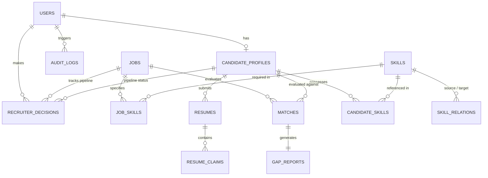

# HireLens AI - Architecture & Database Schema
**An Explainable, Fair & Interactive AI Resume Screening Platform**

## 1. System Architecture Diagram

---

## 2. Core Entities & Philosophy Mapping

| Entity | Purpose & Feature Mapping | Philosophy Alignment |
|---|---|---|
| [`User`](file:///c:/Users/aliya/OneDrive/Desktop(1)/HireLens-AI/backend/models.py#L29-L49) | Recruiter, Candidate, and Admin roles. | Role-Based Access Control (RBAC). |
| [`Job`](file:///c:/Users/aliya/OneDrive/Desktop(1)/HireLens-AI/backend/models.py#L55-L78) | Job postings with `bias_score` & `bias_feedback`. | **F8**: Inclusive JD check before candidates ever apply. |
| [`CandidateProfile`](file:///c:/Users/aliya/OneDrive/Desktop(1)/HireLens-AI/backend/models.py#L84-L109) | Stores headline, experience, and `blind_id`. | **F7**: Blind screening mode (hides PII, college, photo). |
| [`Resume`](file:///c:/Users/aliya/OneDrive/Desktop(1)/HireLens-AI/backend/models.py#L115-L130) | Raw text, SHA-256 hash, and `anonymized_text`. | Data privacy & PII masking. |
| [`Skill`](file:///c:/Users/aliya/OneDrive/Desktop(1)/HireLens-AI/backend/models.py#L136-L147) & [`SkillRelation`](file:///c:/Users/aliya/OneDrive/Desktop(1)/HireLens-AI/backend/models.py#L150-L167) | Semantic Skill Graph (`implies`, `related_to`, weights). | **F1**: Moving beyond rigid keyword ATS filters. |
| [`CandidateSkill`](file:///c:/Users/aliya/OneDrive/Desktop(1)/HireLens-AI/backend/models.py#L170-L184) | Depth score, recency, and resume quote snippet. | **F2**: Distinguishes "used deeply" from "mentioned once". |
| [`Match`](file:///c:/Users/aliya/OneDrive/Desktop(1)/HireLens-AI/backend/models.py#L202-L229) | Factor breakdown + `evidence_trail` + `needs_human_review`. | **F3**: Explainable scores linked to real resume sentences. |
| [`GapReport`](file:///c:/Users/aliya/OneDrive/Desktop(1)/HireLens-AI/backend/models.py#L235-L250) | Matched, missing, learning roadmap & growth evidence. | **F1**: Evidence of growth; never predictions of future. |
| [`ResumeClaim`](file:///c:/Users/aliya/OneDrive/Desktop(1)/HireLens-AI/backend/models.py#L256-L272) | Major claims flagged `Supported` / `Needs Evidence`. | **F4**: Points to verify, never fraud accusations. |
| [`InterviewQuestion`](file:///c:/Users/aliya/OneDrive/Desktop(1)/HireLens-AI/backend/models.py#L278-L293) | Adaptive technical & behavioral questions. | **F10**: Interview targeted at verified candidate gaps. |
| [`RecruiterDecision`](file:///c:/Users/aliya/OneDrive/Desktop(1)/HireLens-AI/backend/models.py#L299-L318) | Stage (`new`, `shortlisted`, `interview`, `offer`). | **Non-negotiable**: Humans make all final decisions. |
| [`AuditLog`](file:///c:/Users/aliya/OneDrive/Desktop(1)/HireLens-AI/backend/models.py#L324-L338) | Append-only immutable log of every AI & human action. | **Compliance & Safety**: Fully auditable AI pipeline. |
